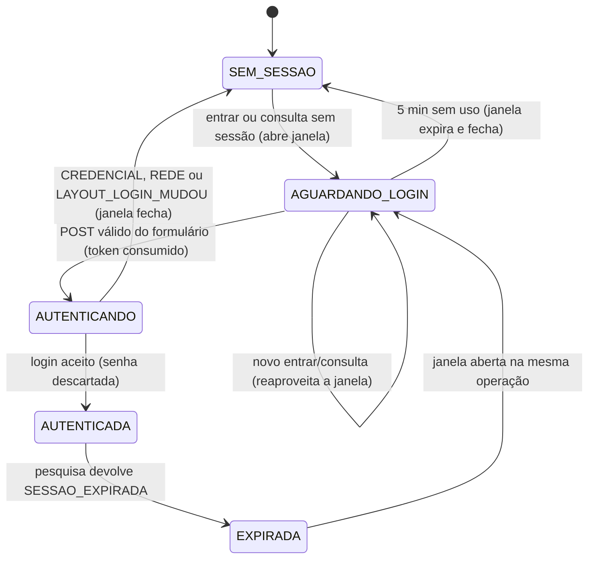

# ARCH-001 — SoftDesk Local: serviço local de sessão + MCP fino + REST

| Campo | Valor |
|-------|-------|
| Versão | 0.8 (v0.6 aprovada em 2026-11-19, folheto do plano v4; v0.7 emenda §17 camada 3 sobre `null` em campo usado, aprovada em 2026-11-21; v0.8 acrescenta o modo `todas` em F3, F4, §7.1, §8.3, §10 e §11, ajuste pedido pelo usuário em 2026-11-21) |
| Data | 2026-11-19 |
| SPEC de origem | `docs/especificacoes/SPEC-001.md` v0.10 |
| Branch | `feat/softdesk-local-mvp` |
| ADRs | `.ai/decisions/ADR-001` a `ADR-009` |

## 1. Contexto e objetivos

O atendente precisa listar a própria fila e fazer pesquisa avançada no SoftDesk pelo Claude, sem que a senha passe pelo chat (norma SIN-NOR-000021, 6.1.1). As rotas usadas (`GET /login`, `POST /login`, `GET /chamado/json`) não são oficiais: o desenho isola o acoplamento em um único adaptador e trata a quebra de formato como evento de primeira classe.

Metas do desenho:

- Uma sessão só, em memória, compartilhada por MCP e REST (RF-08); senha digitada uma vez, numa janela local (RN-02, RN-03, RN-10).
- Somente leitura (RN-01); nada de dado de chamado em disco (RN-13).
- Erros tipados, com mudança de layout/rota nunca confundida com sessão expirada (RN-07, RN-08).
- NFR: REST só em 127.0.0.1 com token por início (RNF-02); no máximo 2 requisições simultâneas ao SoftDesk e 1 varredura (RNF-04); timeout de 20 s sem repetição (RNF-05); logs com `event` e `correlation_id` (RNF-06); Windows + Node >= 20 (RNF-07); SoftDesk simulado (RNF-08).

## 2. Recomendação e alternativas

### 2.1 Abordagem 1 (recomendada): serviço local de longa duração + MCP stdio fino

Um processo `servico` (Node) é o único dono da sessão, da janela de login, do cliente do SoftDesk e do REST em `127.0.0.1`. O MCP stdio, iniciado pelo Claude, não tem regra nem sessão: cada tool vira uma chamada REST ao serviço e devolve o envelope recebido, sem alterar.

Por quê:

- **Login uma vez só.** O Claude Code inicia um processo MCP por sessão de chat e o encerra ao fechar. Se a sessão morasse no MCP, cada chat novo pediria a senha de novo e dois chats teriam duas sessões.
- **Paridade por construção.** O MCP repassa o mesmo envelope do REST; VAL-21 deixa de depender de duas implementações coincidirem.
- **stdout limpo.** O protocolo MCP usa o stdout; o `@clamed/logger` e a janela de login ficam no serviço, fora do processo stdio.
- **Segurança.** Cookies e senha existem em um único processo, iniciado pelo próprio usuário, não por um cliente de IA.

O usuário não inicia nada: o MCP inicia o serviço em segundo plano na primeira chamada (RN-15), como se fosse um MCP comum. Custo: o serviço continua rodando depois que o chat fecha, porque é isso que mantém a sessão e o login único; ele não encerra por ociosidade (decisão do usuário) e só para por comando, ao reiniciar o Windows ou quando o usuário sai; a sessão só termina quando o SoftDesk a rejeita. Corrida entre vários MCPs: a porta fixa garante uma só instância (a segunda sai sem erro e o MCP volta a ler o arquivo de descoberta). Se o serviço não subir em 10 s, o MCP responde `SERVICO_INDISPONIVEL` com o caminho do log (CA-17).

### 2.2 Abordagem 2 (descartada): um processo que é MCP e REST ao mesmo tempo

O primeiro MCP stdio a subir abre o REST e guarda a sessão; os seguintes detectam a porta ocupada e viram clientes dele.

Por que não: a sessão morre quando o chat "líder" fecha (novo login a cada troca de chat); o REST só existe com o Claude aberto; exige eleição de líder e dois modos de operação no mesmo binário; logs e janela de login dividem processo com o stdout do protocolo. Não ganha nada que a abordagem 1 já não dê, porque nela o MCP também inicia o serviço sozinho.

## 3. Visão de sistema

```text
 Claude Code / skill /softdesk          outros clientes locais, testes, CLI
        | stdio (MCP)                              |
        v                                          |
 +-------------------+   HTTP 127.0.0.1:47821      |
 |  mcp.js (fino)    |-----(Bearer token)----------+
 |  1 por chat       |                             v
 +-------------------+        +------------------------------------------+
        ^ lê                  |  servico.js (1 por usuário, longa duração)|
        |                     |  REST -> casos de uso -> portas           |
 %LOCALAPPDATA%\softdesk-     |  sessão em memória (cookies, usuário)     |
 local\servico.json  <--grava-|  janela de login: 127.0.0.1:<aleatória>   |
 (porta, token, pid)          |  cliente SoftDesk (semáforo 2, timeout 20)|
                              +------------------------------------------+
                                   |  https (rede Clamed/VPN)      | abre
                                   v                               v
                          helpdesk.clamed.com.br           navegador padrão
                          /login, /chamado/json            (formulário local)
```

| Caixa | Faz | Não faz |
|-------|-----|---------|
| `mcp.js` | Registra as 7 tools `softdesk_*`, valida entrada, inicia o serviço em segundo plano se ele estiver parado (RN-15), chama o REST, devolve o envelope | Não guarda sessão, não fala com o SoftDesk, não abre janela, não loga em stdout |
| `servico.js` | Sessão, janela de login, casos de uso, REST, logs, notificação | Não escreve no SoftDesk, não grava chamado em disco, não retém senha |
| Janela de login | Formulário local de uso único (RN-10) | Não fica aberta depois do uso nem após 5 min |
| Arquivo de descoberta | Entrega porta e token do REST aos clientes locais | Não contém senha, cookie nem dado de chamado; fica fora do repositório |

## 4. Componentes e responsabilidades (Clean Architecture)

Dependências apontam para dentro: `presentation` → `application` → `domain` ← `infraestructure`.

**Domínio (`core/domain`), puro, sem I/O**

| Item | Conteúdo |
|------|----------|
| `entities/chamado.ts` | `ChamadoBasico` (RN-06), `ChamadoBruto` (registro como veio), `paraBasico(bruto)` |
| `entities/status.ts` | Catálogo fixo dos 14 status (código e nome; fonte: catálogo oficial `listar_status_chamado`, conferido em 19/11/2026), `STATUS_FECHADOS = {2,3,4,6}`, `estaAberto()`, `normalizarStatus(codigo ou nome)` |
| `entities/filtro-pesquisa.ts` | `FiltroPesquisa`, `FILTROS_CONFIRMADOS`, `filtrosNaoConfirmados(filtro)`, `normalizarPaginacao()` (padrão 50, teto 200) |
| `entities/filtro-texto.ts` | `FiltroTexto { solicitante_nome, titulo_contem, prioridade_nome, tipo_nome }`, `normalizarTexto()` (sem acento, minúsculas), `casaTexto(item, filtro)`: todas as palavras pedidas aparecem no campo (`nm_usuario`, `tt_chamado`, `ds_prioridade`, `ds_tipo_chamado`) (RN-16) |
| `entities/sessao.ts` | `EstadoSessao` (`SEM_SESSAO`, `AGUARDANDO_LOGIN`, `AUTENTICANDO`, `AUTENTICADA`, `EXPIRADA`), `ResumoSessao` (usuário, perfil, desde) |
| `entities/config.ts` | `Config` (§8.2) |
| `services/fila.service.ts` | `acumularPagina(acumulador, pagina)`: filtro de abertos, sem repetidos, junta até `limite` e informa a posição de continuação (RN-04, RN-09) |
| `errors/erro-softdesk.ts` | `ErroSoftdesk { codigo, mensagem, acao, destaque }` e a taxonomia de §7.3 |

**Portas (interfaces no domínio)**

| Porta | Métodos (pseudo-assinatura) |
|-------|-----------------------------|
| `ISoftdeskGateway` | `conferirPaginaLogin(sinal): Promise<void>`; `autenticar(usuario, senha, perfil, sinal): Promise<SessaoHttp>`; `pesquisar(sessao, filtro, sinal): Promise<{ lista: ChamadoBruto[]; total: number }>` |
| `ISessaoStore` | `obter(): SessaoHttp ou null`; `guardar(sessao, resumo)`; `descartar(motivo)`; `resumo(): ResumoSessao`; `estado(): EstadoSessao` |
| `IJanelaLogin` | `abrirOuReaproveitar(): InfoJanela`; `aguardarResultado(ms): Promise<ResultadoLogin ou 'TEMPO'>`; `info(): InfoJanela ou null`; `fechar()` |
| `IAbridorNavegador` | `abrir(url): Promise<boolean>` |
| `ILogger` | `info/warn/error(msg, { event, keywords, ...campos })` |
| `INotificador` | `alertar(codigo): void` (nunca lança) |
| `IRelogio` | `agora(): Date` (trocado nos testes) |

**Casos de uso (`core/application/useCases`), um arquivo por fluxo**

| Caso de uso | Faz | RF |
|-------------|-----|----|
| `entrar.use-case.ts` | Sessão válida → devolve estado; senão abre/reaproveita a janela e espera até 120 s | RF-01 |
| `estado-sessao.use-case.ts` | Devolve estado, resumo, janela aberta e último alerta de contrato | RF-02 |
| `listar-fila.use-case.ts` | Leitura progressiva de §6 F3, com uma execução idêntica por vez | RF-03 |
| `pesquisar.use-case.ts` | Valida filtro, decide status no servidor ou no cliente, pagina | RF-04 |
| `obter-chamado.use-case.ts` | Pesquisa pelo código e exige igualdade exata | RF-05 |
| `verificar-saude.use-case.ts` | Sem sessão confere a página de login; com sessão faz pesquisa mínima | RF-06 |
| `services/exigir-sessao.ts` | Compartilhado: sem sessão abre a janela e lança `AGUARDANDO_LOGIN`; ao receber `SESSAO_EXPIRADA` do gateway, descarta a sessão e abre a janela (RN-14) | RN-14 |
| `services/alerta-contrato.ts` | Compartilhado: ao passar um erro com `destaque`, registra log, guarda o último alerta em memória e chama `INotificador` | RF-07 |

**Adaptadores (`infraestructure`)**

| Adaptador | Implementa | Observação |
|-----------|-----------|------------|
| `softdesk/softdesk-http.gateway.ts` | `ISoftdeskGateway` | Único arquivo que conhece URLs, `pesq_*`, XSRF e cabeçalhos |
| `softdesk/contrato.ts` | funções puras `classificarLogin`, `classificarPesquisa` | Tabela de decisão de RN-08 (§7.4) |
| `softdesk/cookie-jar.ts`, `softdesk/semaforo.ts` | apoio | Jar mínimo em memória (do protótipo); semáforo de 2 vagas, FIFO |
| `sessao/sessao-memoria.store.ts` | `ISessaoStore` | Um objeto em memória; nada em disco |
| `login/janela-login.server.ts`, `login/pagina.ts` | `IJanelaLogin` | `node:http` em porta aleatória (reaproveita o protótipo) |
| `login/abridor-navegador.windows.ts` | `IAbridorNavegador` | `execFile('cmd', ['/c','start','',url])` |
| `logger/clamed-logger.adapter.ts`, `logger/contexto.ts` | `ILogger` | `LoggerProvider` + `AsyncLocalStorage` para `correlation_id` |
| `notificacao/notificador-windows.ts` | `INotificador` | Balão via PowerShell; opcional (RF-07, Could) |
| `descoberta/arquivo-descoberta.ts` | grava/lê `servico.json` | Usado pelo serviço (grava) e pelo MCP/CLI (lê) |

**Entrada (`presentation`)**: `rest/` (servidor, roteador, autenticação, controllers finos) e `mcp/` (tools e cliente do serviço). **Composição**: `shared/container/index.ts` monta tudo por função (`montarContainer(config, substitutos?)`), sem `tsyringe`: são cerca de 12 objetos com um único ciclo de vida, e a função aceita substitutos nos testes. É desvio local do padrão do time, registrado no ADR-003.

**Escolhas de biblioteca**

| Tema | Escolha | Motivo | Descartado |
|------|---------|--------|-----------|
| Servidor HTTP (REST e janela) | `node:http` nativo + roteador próprio pequeno | 9 rotas em loopback; o protótipo validado já usa; menos dependências e menos superfície | Express 4 (padrão do time): dezenas de pacotes transitivos para 9 rotas |
| Cliente HTTP | `fetch` nativo do Node 20 com `redirect: 'manual'` e `AbortSignal.timeout` | O protótipo (validado em produção) já usa `fetch` com `redirect: 'manual'`, mas segue os redirecionamentos em todas as chamadas; neste desenho a pesquisa deixa de segui-los para distinguir sessão expirada, e essa detecção por `Location` é nova e não foi validada (Q-02) | axios/undici explícito: nada a ganhar |
| MCP | `@modelcontextprotocol/sdk` + `zod` | Mesmo molde do `mcp-sybase-readonly` | — |
| Logs | `@clamed/logger` (`LoggerProvider`) | Decisão da SPEC | — |
| Módulos | CommonJS, `tsc` para `dist/` | Igual ao molde; jest sem configuração extra | ESM |

Dependências de produção: `@modelcontextprotocol/sdk`, `zod`, `@clamed/logger`. Mais nenhuma.

## 5. Modelo de dados (somente memória; não há banco)

| Estrutura | Campos | Regras |
|-----------|--------|--------|
| `SessaoHttp` | `cookies: Map<nome, valor>`, `criadaEm` | Só no `ISessaoStore`; nunca serializada; apagada em expiração ou parada |
| `ResumoSessao` | `usuario`, `perfil (A, U ou T)`, `desde` | Aparece só na resposta de estado; nunca em log (RN-13) |
| `InfoJanela` | `aberta`, `expiraEm`, `navegadorAberto`; internos: `porta`, `token`, `usado` | Token de 24 bytes aleatórios; uso único; vida de 5 min |
| `UltimoAlerta` | `codigo`, `quando` | Último `LAYOUT_LOGIN_MUDOU`/`CONTRATO_ROTA_MUDOU` visto |
| `ChamadoBasico` | `codigo`←`cd_chamado`, `titulo`←`tt_chamado`, `status_codigo`←`st_chamado`, `status`←`ds_status`, `prioridade`←`ds_prioridade`, `tipo`←`ds_tipo_chamado`, `solicitante`←`nm_usuario`, `data_abertura`←`da_chamado`, `hora_abertura`←`ha_chamado`, `interacoes`←`qtd_interacoes`, `cd_atendente` | Campo ausente vira `null`, sem erro (só `lista` e `treeview.total` são contrato) |
| `ChamadoBruto` | o item de `lista` como veio (cerca de 70 campos) | Devolvido sem remodelar (RN-06) |

Em disco existem só: o arquivo de descoberta (porta, token, pid), o `config.json` opcional e os logs (códigos e tipos de erro). Nenhum deles tem dado de chamado, senha ou cookie.

## 6. Fluxos de negócio no sistema

### F1 — Entrar (RF-01, CA-01, VAL-14)

Máquina de estados da sessão (mora no `ISessaoStore` + `IJanelaLogin`):



1. `softdesk_entrar` ou `POST /v1/sessao/entrar` chega ao `entrar.use-case`.
2. Estado `AUTENTICADA`: devolve o resumo, sem abrir janela e sem chamar o SoftDesk.
3. Senão `IJanelaLogin.abrirOuReaproveitar()`: se não há janela, sobe `node:http` em `127.0.0.1:0`, gera o token, arma o temporizador de 5 min e chama `IAbridorNavegador.abrir(url)`. Se há janela, nada novo é aberto (RN-14).
4. O caso de uso espera `aguardarResultado(120 s)`. A espera de 120 s é de quem chamou; a vida de 5 min é da janela. Estourar a espera devolve `AGUARDANDO_LOGIN` e a janela continua aberta.
5. No navegador: `GET /?t=<token>` devolve o formulário (usuário, senha, perfil com o padrão da configuração). `POST /entrar` com token válido marca o token como usado, passa a `AUTENTICANDO` e chama `ISoftdeskGateway.autenticar`.
6. Sucesso: `ISessaoStore.guardar`, página "Pronto, pode fechar", janela encerrada, quem esperava recebe o estado. Falha: página mostra só o código e a ação, janela encerrada, quem esperava recebe o erro; nova tentativa exige novo "entrar".
7. A senha existe só como variável local do tratamento do `POST`; não entra em estado, erro nem log. O `usuario` fica no `ResumoSessao`.

Proteções da janela (RN-10, CA-02, CA-03): `Host` diferente de `127.0.0.1:<porta>` → 403; token comparado com `timingSafeEqual`; corpo limitado a 4 KB; cabeçalhos `Cache-Control: no-store`, `Referrer-Policy: no-referrer`, `X-Frame-Options: DENY` e CSP `default-src 'none'; style-src 'unsafe-inline'; img-src data:; script-src 'nonce-<aleatório por resposta>'; form-action 'self'; frame-ancestors 'none'` (a página é a de §19); token usado ou vencido → 403 e servidor fechado.

Endereço manual: o endereço da janela contém o token e por isso **não aparece em resposta de MCP**. Se o navegador não abrir, a resposta orienta rodar `npm run entrar` no terminal, que consulta a rota operacional `GET /v1/sessao/janela` e imprime o endereço para o usuário (ADR-007).

### F2 — Estado da sessão (RF-02)

`estado-sessao.use-case` lê `ISessaoStore` e `IJanelaLogin.info()` e devolve `{ estado, autenticada, usuario, perfil, desde, janela, ultimo_alerta }`. Não chama o SoftDesk.

### F3 — Minha fila (RF-03, CA-04 a CA-06, VAL-02, VAL-04, VAL-12)

Leitura progressiva e sem estado entre chamadas: o atendente tem mais de 200 chamados abertos, então a fila é percorrida por partes. Entradas: `inicio` (posição no SoftDesk, padrão 0) e `limite` (padrão 50, teto 200); opcionalmente os filtros de texto de RN-16 (`solicitante_nome`, `titulo_contem`, `prioridade_nome`, `tipo_nome`), aplicados no cliente e marcados com `filtro_texto_no_cliente: true`.

```text
exigirSessao()                                  # sem sessão: abre janela, AGUARDANDO_LOGIN
se já existe leitura idêntica (mesmo inicio e limite) em andamento: aguarda e devolve o mesmo resultado
senão, se há outra leitura da fila em andamento: aguarda a vez (uma leitura de fila por vez, RNF-04)
itens = [], vistos = Set, posicao = inicio, proximo = nulo
para n de 1 a 15:
    r = gateway.pesquisar({ atendente: [config.cdAtendente], inicio: posicao, limite: 200 })
    se n == 1: totalSoftdesk = r.total
    para cada (indice, item) de r.lista, na ordem:
        se vistos tem item.cd_chamado: ignora           # página deslocou durante a leitura
        se item.cd_atendente != config.cdAtendente: ignora
        se status fechado {2,3,4,6}: ignora
        se não casaTexto(item, filtrosTexto): ignora       # RN-16, quando houver filtro de texto
        itens.push(paraBasico(item)); vistos.add(item.cd_chamado)
        se itens.length == limite: proximo = posicao + indice + 1; sai de todos os laços
    posicao += r.lista.length
    se r.lista.length < 200 ou posicao >= totalSoftdesk: proximo = nulo; sai do laço
se saiu pelo teto de 15 páginas sem juntar `limite`: incompleto = true; proximo = posicao
devolve { itens, proximo_inicio: proximo, total_softdesk: totalSoftdesk, paginas_lidas, incompleto }
```

- O status **não** vai ao servidor: a fila é "tudo que não está fechado" e só `EM_ATENDIMENTO` é nome validado (Q-01).
- `proximo_inicio` é a posição do SoftDesk onde a leitura seguinte começa (`null` quando acabou); quem chama continua com ele até vir `null`. Não existe "total de abertos": ele só seria conhecido lendo tudo; `total_softdesk` inclui os fechados e é só informação.
- Chamado novo durante o uso desloca as posições: a leitura seguinte pode repetir um item já recebido. Dentro de uma chamada os repetidos são descartados por código; entre chamadas, quem chama (a skill) descarta por código.
- A leitura ocupa 1 das 2 vagas do semáforo e deixa a outra para pesquisas avulsas.
- Qualquer erro em uma página encerra a leitura com esse erro; não há resultado parcial fora do caso `incompleto`.
- Prazo total de 90 s por leitura (configurável); estourado, `REDE` com a mensagem "leitura excedeu o tempo" (no modo `todas`, ver abaixo).
- Cancelamento: um `AbortController` por leitura, acionado quando todos os que aguardavam desistiram (conexão REST fechada), quando a sessão é descartada, no prazo total ou na parada do serviço; o sinal é propagado até o `fetch`.

**Modo `todas` (RF-03, RN-09, CA-31, CA-33, CA-34, VAL-35 a VAL-37).** Entrada opcional `todas` (booleano, padrão `false`; no REST, `?todas=true|false`, convertido pelo controller). O mesmo laço, as mesmas páginas de 200 e o mesmo semáforo, com três diferenças: o `limite` interno passa a ser o teto de itens (300, constante `MAX_ITENS_TODAS`), o teto de páginas passa a ser o de `todas` (15, `MAX_PAGINAS_TODAS`), há um teto de tamanho (60.000 bytes do JSON dos itens, `MAX_BYTES_TODAS`, para a resposta caber numa tool MCP) e o prazo vencido não vira erro. Os tetos são reduzíveis pelo container nos testes (`maxItensTodas`, `maxPaginasTodas`, `maxBytesTodas`); o prazo é o da varredura (90 s, `prazoVarreduraMs` nos testes). Regras:

- `todas: true` com `limite` → `FILTRO_INVALIDO` (campos `todas` e `limite`), sem chamar o SoftDesk: o pedido é ambíguo ("quantos?"). `todas: false` equivale a omitir. `inicio` continua permitido (continuar a partir de `proximo_inicio`). `todas` não booleano → `FILTRO_INVALIDO`. A validação é um `superRefine` do schema zod compartilhado pelo REST e pelo MCP.
- Parada por tamanho: ao aceitar um item, o acumulador soma o JSON dele (`JSON.stringify` do básico, em bytes, mais 1); se o item passaria de 60.000 bytes e já há itens, ele NÃO entra: `incompleto: true`, `parada_por: 'tamanho'`, `proximo_inicio` = posição desse item (a continuação começa nele). Um único item maior que o limite sozinho é aceito (não trava). Sem sentido de privacidade novo: o log leva só `parada_por`.
- Limitação aceita (usuário único): um `todas` longo (até 90 s) segura a vez da varredura (RNF-04); pedidos que chegarem nesse tempo esperam e, se esgotarem o próprio prazo antes de ler a primeira página, recebem `REDE`. Para repetir é só pedir de novo.
- Fim real: o teto de itens no último item de uma página curta é fim (`proximo_inicio` nulo, sem `incompleto`), mesmo se o total da primeira página encolheu durante a leitura.
- A continuação entre chamadas é por posição: só evita repetidos com a lista estável; o cliente descarta repetidos por código.
- Teto de itens com mais por ler → `incompleto: true`, `parada_por: 'itens'`, `proximo_inicio` logo após o último item devolvido. Se o teto coincide com o fim da lista, não é incompleto. Teto de páginas → `parada_por: 'paginas'`, `proximo_inicio = posicao`. Prazo vencido depois de ler pelo menos uma página → devolve o que foi lido, `incompleto: true`, `parada_por: 'prazo'`, `proximo_inicio = posicao` (a página em voo é descartada: não há repetidos ao continuar). Prazo vencido antes de qualquer página (inclusive na espera pela vez), erro de página, sessão que caiu e cancelamento continuam sendo erro, como hoje; sem `todas`, o prazo estourado segue sendo `REDE` sem parcial.
- Resposta (campos acrescentados só no modo `todas`, para o formato sem `todas` não mudar): `todas: true`, `itens_devolvidos`, `teto_itens`, `parada_por` (`'paginas' | 'itens' | 'tamanho' | 'prazo' | null`); `limite_pedido` e `limite_aplicado` vêm `null`.
- Leituras idênticas em andamento só se juntam se forem do mesmo modo (`todas` entra na chave de compartilhamento). Uma varredura por vez (RNF-04) e o cancelamento são os mesmos.
- Log (§8.3): `todas` e `parada_por` entram na lista de permissão; título, nome e valor de filtro continuam de fora.

### F4 — Pesquisa avançada (RF-04, CA-07 a CA-09, CA-18, CA-22, VAL-03, VAL-24)

1. Validação estrita (zod `strict`): campo desconhecido, tipo errado ou `limite < 1` → `FILTRO_INVALIDO`, sem chamar o SoftDesk. `limite > 200` → usa 200 e informa `limite_pedido` e `limite_aplicado`.
2. `status` aceita código (0 a 14) ou nome do catálogo; valor desconhecido → `FILTRO_INVALIDO`. Se o conjunto pedido é exatamente `{1}`, o gateway envia `pesq_st_chamado[]=EM_ATENDIMENTO`. Qualquer outro conjunto: nada de status vai ao servidor; a leitura é progressiva como em F3 (páginas de 200 a partir de `inicio`, filtro no cliente até juntar `limite` itens ou ler 15 páginas) e a resposta marca `filtro_status_no_cliente: true` e traz `proximo_inicio`. Os filtros de texto de RN-16 entram na mesma leitura progressiva, também no cliente (`filtro_texto_no_cliente: true`); sem filtro de servidor que restrinja a pesquisa (como o atendente), a leitura cobre só os 3.000 chamados mais novos (15 páginas de 200) e a resposta marca `incompleto: true`.
3. `exigirSessao()`, depois `gateway.pesquisar(filtro)`.
4. Resposta: `{ itens: ChamadoBasico[], total, inicio, proximo_inicio, limite_aplicado, limite_pedido, filtro_status_no_cliente, filtro_texto_no_cliente, incompleto, filtros_nao_confirmados }`. `total` é sempre `treeview.total` (antes do filtro no cliente); `proximo_inicio` é `null` quando não há mais itens e também quando a pesquisa não usa filtro de status no cliente. `filtros_nao_confirmados` lista os nomes usados fora de `{codigo, atendente, status, prioridade, grupo_solucao, tipo_chamado, cliente}` (CA-09).
5. **`todas: true`** (RF-04, CA-32): a pesquisa sempre usa a leitura progressiva de F3 (páginas de 200 a partir de `inicio`), mesmo quando só há filtros de servidor, com os mesmos tetos e a mesma resposta do modo `todas` de F3 (`todas`, `itens_devolvidos`, `teto_itens`, `parada_por`, `incompleto`, `proximo_inicio`; `limite_*` nulos). `total` continua sendo `treeview.total`. Com `todas`, `proximo_inicio` só vem preenchido quando a leitura parou por teto ou prazo. `todas` com `limite` é `FILTRO_INVALIDO`.

### F5 — Chamado completo (RF-05, CA-10, CA-11)

`exigirSessao()`; `gateway.pesquisar({ codigo, limite: 10 })`; procura o item com `cd_chamado` exatamente igual; achou → `{ chamado: ChamadoBruto }`; não achou → `NAO_ENCONTRADO` (inexistente ou fora da visibilidade são indistinguíveis).

### F6 — Saúde (RF-06, CA-12, CA-13, CA-19, VAL-22)

Sem sessão: `gateway.conferirPaginaLogin()` (só `GET /login`, cookie XSRF presente); **não** abre janela nem pede senha. Com sessão: pesquisa mínima (`limite: 1`, atendente configurado) e confere o contrato. Devolve `{ ok: true, modo: 'login' ou 'pesquisa', duracao_ms }` ou o erro tipado. Com sessão e resposta `SESSAO_EXPIRADA`, vale a regra geral de F7.

### F7 — Sessão expirou no meio do uso (UC-03, CA-14, VAL-08, VAL-16)

O gateway lança `SESSAO_EXPIRADA`; `exigir-sessao` descarta cookies, abre a janela e devolve `SESSAO_EXPIRADA` com `janela.aberta: true`. Não há relogin (a senha não existe mais) nem repetição da consulta. As consultas seguintes recebem `AGUARDANDO_LOGIN` até o login.

### F8 — Mudança de layout ou rota (RF-07, CA-12, CA-13, CA-20)

`contrato.ts` classifica; `alerta-contrato` registra `error` com `keywords: ['softdesk_contrato_mudou']`, guarda `ultimo_alerta` (visível em estado e saúde) e chama o notificador (no máximo um balão por código a cada 10 min). O envelope de erro sai com `error.destaque: true` e o bloco `alerta` (§7.3).

### F9 — Serviço parado: início automático (RN-15, CA-17, CA-24)

O MCP lê o arquivo de descoberta a cada chamada. Arquivo ausente, conexão recusada ou 401 (token de um início anterior): o MCP inicia o serviço (`process.execPath` com `dist/servico.js`, `detached`, `windowsHide`, `stdio: 'ignore'`, `unref`) e espera até 10 s o arquivo de descoberta e a resposta de `GET /v1/servico`. Vários MCPs ao mesmo tempo disputam a porta; quem perde só volta a ler o arquivo. Se o serviço não subir, o MCP responde `SERVICO_INDISPONIVEL`, com a ação "veja o log em `%LOCALAPPDATA%\softdesk-local\logs`". A skill repassa esse texto. O serviço não encerra por ociosidade (RN-15): fica rodando até `npm run servico:parar`, reinício do Windows ou saída do usuário; a sessão só cai quando o SoftDesk a rejeita.

## 7. API / contratos

### 7.1 Catálogo de tools MCP e rotas REST

| Operação | Tool MCP | REST | Entrada | `dados` em caso de sucesso |
|----------|----------|------|---------|----------------------------|
| Entrar | `softdesk_entrar` | `POST /v1/sessao/entrar` | nenhuma | `{ estado, autenticada, usuario, perfil, desde }` |
| Estado | `softdesk_estado_sessao` | `GET /v1/sessao` | nenhuma | o mesmo, mais `janela` e `ultimo_alerta` |
| Minha fila | `softdesk_minha_fila` | `GET /v1/fila?inicio=&limite=&todas=true\|false&solicitante_nome=&titulo_contem=&prioridade_nome=&tipo_nome=` | `inicio`, `limite`, `todas` e filtros de texto (todos opcionais; `todas: true` não aceita `limite`) | F3 |
| Pesquisar | `softdesk_pesquisar` | `POST /v1/chamados/pesquisa` | filtros abaixo | F4 |
| Chamado completo | `softdesk_chamado_completo` | `GET /v1/chamados/{codigo}` | `codigo` inteiro > 0 | `{ chamado }` |
| Atividades do chamado | `softdesk_atividades` | `GET /v1/chamados/{codigo}/atividades` | `codigo` inteiro > 0 | lista só de leitura (§18); `NAO_DISPONIVEL` enquanto a rota não for descoberta (Q-07) |
| Saúde | `softdesk_saude` | `GET /v1/saude` | nenhuma | F6 |
| (operacional) | — | `GET /v1/servico` | — | `{ versao, pid, iniciado_em }` |
| (operacional) | — | `GET /v1/sessao/janela` | — | `{ aberta, url, expira_em }` |
| (operacional) | — | `POST /v1/servico/parar` | — | `{ parando: true }` |

A pesquisa usa `POST` com corpo JSON para que palavra-chave e nomes não fiquem em URL. As três rotas operacionais existem só no REST e ficam fora da paridade de RF-08.

Filtros de `softdesk_pesquisar` (iguais no corpo REST; todos opcionais):

| Campo | Tipo | Parâmetro do SoftDesk | Confirmado? |
|-------|------|-----------------------|-------------|
| `codigo` | inteiro | `pesq_cd_chamado` | sim |
| `atendente` | inteiro[] | `pesq_cd_atendente[]` | sim (produção) |
| `status` | (inteiro ou texto)[] | `pesq_st_chamado[]` só para `{1}`; demais no cliente | só `EM_ATENDIMENTO` |
| `prioridade`, `grupo_solucao`, `tipo_chamado`, `cliente` | inteiro[] | `pesq_prioridade_chamado[]`, `pesq_grupo_solucao_chamado[]`, `pesq_tipo_chamado[]`, `pesq_cd_cliente[]` | sim |
| `palavra_chave` | texto até 200 | `pesq_ds_chamado` | por convenção |
| `area`, `solicitante`, `servico`, `categoria` | inteiro | `pesq_cd_area`, `pesq_cd_usuario`, `pesq_servico_chamado`, `pesq_categoria_chamado` | por convenção |
| `descricao_categoria` | texto | `pesq_descricao_categoria_chamado` | por convenção |
| `periodo`, `periodo_ini`, `periodo_fim`, `termino_previsto` | inteiro, texto, texto, texto (repassados como vierem) | `pesq_periodo`, `pesq_periodo_ini`, `pesq_periodo_fim`, `pesq_termino_previsto_chamado` | por convenção |
| `incluir_inativos` | booleano | `pesq_bus_inativos` | por convenção |
| `solicitante_nome`, `titulo_contem`, `prioridade_nome`, `tipo_nome` | texto de 1 a 100 caracteres | Não vão ao servidor: filtro no cliente sobre `nm_usuario`, `tt_chamado`, `ds_prioridade` e `ds_tipo_chamado` (RN-16); valem também em `softdesk_minha_fila` | — |
| `inicio` | inteiro >= 0, padrão 0 | `start` | sim |
| `limite` | inteiro >= 1, padrão 50, teto 200 | `limit` | sim |
| `todas` | booleano, padrão `false` (no corpo REST booleano JSON; na query da fila `true` ou `false`) | Não vai ao servidor: o serviço lê as páginas de 200 sozinho até o fim ou até os tetos (15 páginas, 300 itens, 60.000 bytes, 90 s). `todas: true` com `limite` → `FILTRO_INVALIDO`; `inicio` permitido | — |

Parâmetros fixos enviados sempre (do protótipo e do `mcp-softdesk`): `cd_pasta=8`, `pesq_tp_pesquisa=0`, `pesq_cd_tecnico=0`, `pesq_tp_tag=1`, `pesq_flag_periodo=1`, `tp_requisicao=PES_RESULTADO`, `tp_usuario=PES`, `cd_area=0`, `cd_cliente=0`, `cd_grupo_solucao=0`.

Nenhuma tool ou rota tem campo de senha, usuário ou cookie. Os schemas são estritos: um campo `senha` extra é recusado com `FILTRO_INVALIDO` (VAL-15).

### 7.2 Autenticação do REST e arquivo de descoberta (RNF-02, Q-03)

- O serviço escuta em `127.0.0.1`, porta fixa configurável (padrão **47821**). Porta ocupada → o serviço encerra com a mensagem "já existe um serviço rodando ou a porta está em uso" (também é o que garante instância única).
- A cada início gera um token de 32 bytes aleatórios (hex) e grava `%LOCALAPPDATA%\softdesk-local\servico.json` com `{ porta, token, pid, iniciado_em, versao }`. O diretório fica no perfil do usuário (ACL herdada: o próprio usuário, SYSTEM e Administradores); o serviço tenta restringir a ACL da **pasta** (`icacls <pasta> /inheritance:r /grant:r <usuario>:(OI)(CI)F`) **antes** de gravar o arquivo, para não haver janela de exposição, e registra `warn` se falhar. O arquivo é apagado na parada.
- Clientes (MCP, CLI, testes) leem o arquivo e enviam `Authorization: Bearer <token>`. O token nunca vai para o chat, para log, para resposta, para variável de ambiente nem para o repositório.
- Toda requisição passa por: `Host` igual a `127.0.0.1:<porta>` (senão 403); presença do cabeçalho `Origin` → 403 (bloqueia página de navegador); token comparado com `timingSafeEqual` (senão 401 `NAO_AUTORIZADO`); corpo JSON de até 16 KB. Sem CORS.
- Alternativas descartadas: token impresso no terminal (teria de ser copiado à mão e acabaria no chat); token em variável de ambiente do MCP (o token muda a cada início do serviço, e a configuração do MCP é arquivo); named pipe com ACL (a SPEC pede REST em 127.0.0.1 e o pipe criaria um segundo transporte).

### 7.3 Envelope e erros (RN-07)

```json
{ "success": true, "dados": { }, "correlation_id": "..." }
{ "success": false,
  "error": { "code": "CONTRATO_ROTA_MUDOU", "message": "...", "acao": "...", "destaque": true },
  "alerta": { "titulo": "ATENÇÃO: o SoftDesk mudou a rota de pesquisa", "o_que_fazer": "..." },
  "janela": { "aberta": false }, "correlation_id": "..." }
```

No MCP o envelope vai como texto JSON (`toolResult`, molde do `mcp-sybase-readonly`), com `isError` quando `success` é `false`. `alerta` só existe nos dois códigos de destaque; `janela` só nos códigos de sessão. `aviso_deriva: { campos: [...] }` aparece em respostas de sucesso quando um campo usado nas listas faltou ou mudou de tipo (RN-17, §17).

| Código | Origem | HTTP | Destaque | Efeito colateral |
|--------|--------|------|----------|------------------|
| `AGUARDANDO_LOGIN` | sem sessão; espera de 120 s esgotada | 409 | não | abre/reaproveita janela |
| `SESSAO_EXPIRADA` | pesquisa 401/403 ou redirecionada a `/login` | 409 | não | descarta sessão, abre janela |
| `CREDENCIAL` | login 401 ou `status: false` | 422 | não | janela fecha; mensagem fixa, sem repetir o usuário nem a `mensagem` do SoftDesk |
| `REDE` | falha de conexão, timeout, 5xx, prazo da varredura | 502 | não | nenhum; sem repetição |
| `LAYOUT_LOGIN_MUDOU` | página de login sem XSRF; login fora do contrato | 502 | **sim** | log, `ultimo_alerta`, notificação |
| `CONTRATO_ROTA_MUDOU` | pesquisa fora do contrato | 502 | **sim** | log, `ultimo_alerta`, notificação |
| `NAO_ENCONTRADO` | código sem item exato | 404 | não | — |
| `FILTRO_INVALIDO` | validação de entrada | 400 | não | não chama o SoftDesk |
| `NAO_AUTORIZADO` | REST sem token ou token errado (401); `Host` ou `Origin` recusados (403) | 401 ou 403 | não | — (novo; ver §13) |
| `SERVICO_INDISPONIVEL` | só no MCP: não conseguiu iniciar ou alcançar o serviço em 10 s | — | não | — (novo; ver §13) |
| `ERRO_INTERNO` | exceção não prevista | 500 | não | log `error` sem dados de chamado |
| `NAO_DISPONIVEL` | atividades pedidas sem a rota descoberta (Q-07) | 501 | não | — (novo; SPEC §11) |

### 7.4 Detecção de contrato (RN-08)

Mora em `infraestructure/softdesk/contrato.ts`: é conhecimento do formato de fio, e os tipos de erro são do domínio. Avaliação na ordem, a primeira que casar decide.

| Chamada | Condição | Resultado |
|---------|----------|-----------|
| qualquer | falha do `fetch`, timeout de 20 s, HTTP 5xx | `REDE` |
| `GET /login` | status diferente de 200 depois de até 5 redirecionamentos, ou sem cookie `XSRF-TOKEN` | `LAYOUT_LOGIN_MUDOU` |
| `POST /login` | HTTP 401 | `CREDENCIAL` |
| `POST /login` | não é JSON, ou JSON sem `status` booleano | `LAYOUT_LOGIN_MUDOU` |
| `POST /login` | `status: false` | `CREDENCIAL` |
| `GET /chamado/json` | HTTP 401 ou 403 | `SESSAO_EXPIRADA` |
| `GET /chamado/json` | HTTP 3xx com `Location` cujo caminho termina em `/login` | `SESSAO_EXPIRADA` |
| `GET /chamado/json` | outro 3xx, outro 4xx, não JSON, JSON sem `lista` array ou sem `treeview.total` numérico | `CONTRATO_ROTA_MUDOU` |

A pesquisa nunca segue redirecionamento. O erro leva `evidencia` (`http_status`, `content_type`, caminho do `Location`), sem corpo e sem cabeçalhos, para o log. O gateway guarda os `Set-Cookie` de toda resposta, porque o SoftDesk pode renovar o token (o protótipo lê o cookie uma vez; guardar a cada resposta é novo e barato).

## 8. Infra, configuração, logs e operação

### 8.1 Execução no Windows

Sem Docker: o serviço precisa abrir o navegador do usuário. Node >= 20, PowerShell.

| Script npm | Faz |
|-----------|-----|
| `build` | `tsc` para `dist/` |
| `servico` | `node dist/servico.js` em primeiro plano (desenvolvimento) |
| `servico:iniciar` | (opcional: o MCP já inicia o serviço sozinho) `scripts/iniciar-servico.ps1`: se `GET /v1/servico` responde, avisa que já roda; senão `Start-Process node dist\servico.js -WindowStyle Hidden` e espera o arquivo de descoberta (até 10 s) |
| `servico:parar` | `scripts/parar-servico.ps1`: `POST /v1/servico/parar` com o token do arquivo; se não responder, encerra o `pid` do arquivo só depois de conferir que a linha de comando do processo contém `dist\servico.js` (o PID pode ter sido reaproveitado por outro programa) |
| `servico:estado` | Mostra `GET /v1/servico` e `GET /v1/sessao` |
| `entrar` | `node dist/cli-entrar.js`: chama `POST /v1/sessao/entrar` e, se o navegador não abriu, imprime o endereço de `GET /v1/sessao/janela` |
| `mcp` | `node dist/mcp.js` (quem chama é o Claude) |
| `test` | `jest --runInBand` |

Registro no Claude Code, sem segredo algum (`claude mcp add softdesk-local --scope user -- node <caminho>\dist\mcp.js` ou o bloco abaixo):

```json
{ "mcpServers": { "softdesk-local": {
    "command": "node",
    "args": ["C:\\Users\\<usuario>\\Desenvolvimentos\\01-PROJECTS\\ACTIVE\\softdesk-local\\dist\\mcp.js"] } } }
```

O caminho fica gravado em `~/.claude.json`: mover a pasta do repositório exige atualizar o registro.

**Claude Code no WSL.** O serviço roda só no Windows (a janela de login local falhou no WSL por causa não identificada, e o serviço escuta em `127.0.0.1` do Windows). O MCP usado pelo WSL é registrado com `node.exe` e o caminho do Windows (`claude mcp add softdesk-local --scope user -- node.exe 'C:\...\dist\mcp.js'`), para o processo MCP rodar no Windows pela interoperabilidade do WSL, onde o serviço escuta e onde fica `%LOCALAPPDATA%`. Não foi testado: validar no fragmento 7 (R9). Se não funcionar, o plano B é fora desta entrega: o serviço escutar também numa interface alcançável pelo WSL, o que exigiria rever RNF-02.

**Parada e início automático.** Parada (`SIGINT`, `SIGTERM` ou a rota): fecha a janela, cancela a varredura, descarta a sessão, apaga o arquivo de descoberta. Início automático com o Windows fica documentado no README como passo opcional (atalho na pasta Inicializar), fora desta entrega.

README mínimo previsto: o que é e o que não faz; pré-requisitos (Node 20, rede Clamed, registro npm interno para `@clamed/logger`); instalar e compilar; iniciar, parar e ver estado; registrar o MCP; configurar; como entrar; tabela de códigos de erro e o que fazer; o que fazer em `LAYOUT_LOGIN_MUDOU`/`CONTRATO_ROTA_MUDOU`; onde ficam os logs; keywords de log.

### 8.2 Configuração (RN-12)

Não há segredo de configuração e não há `.env`. Precedência: variável de ambiente > `%LOCALAPPDATA%\softdesk-local\config.json` (opcional) > padrão. Lida no início do serviço; mudar exige reiniciar. Schema estrito: chave desconhecida impede o início.

| Chave (`config.json`) | Variável | Padrão | Regra |
|-----------------------|----------|--------|-------|
| `baseUrl` | `SOFTDESK_LOCAL_BASE_URL` | `https://helpdesk.clamed.com.br` | `https` obrigatório, exceto host `127.0.0.1`/`localhost` (simulador) |
| `cdAtendente` | `SOFTDESK_LOCAL_CD_ATENDENTE` | `393` | inteiro > 0 |
| `perfilPadrao` | `SOFTDESK_LOCAL_PERFIL_PADRAO` | `A` | `A`, `U` ou `T` |
| `esperaLoginSegundos` | `SOFTDESK_LOCAL_ESPERA_LOGIN_S` | `120` | 1 a 280 (abaixo da vida da janela) |
| `porta` | `SOFTDESK_LOCAL_PORTA` | `47821` | 1024 a 65535 |
| `prazoVarreduraSegundos` | `SOFTDESK_LOCAL_PRAZO_VARREDURA_S` | `90` | 20 a 300 |
| `notificarWindows` | `SOFTDESK_LOCAL_NOTIFICAR` | `true` | booleano || `nivelLog` | `LOG_LEVEL` | `info` | níveis do logger |
| (diretório) | `SOFTDESK_LOCAL_DIR` | `%LOCALAPPDATA%\softdesk-local` | usado pelo serviço e pelo MCP; os testes apontam para pasta temporária |

Timeout por chamada (20 s), 2 vagas do semáforo, 15 páginas, 200 por página, 200 itens e 5 min da janela são constantes de regra (SPEC), não configuração; os testes as trocam pelo container.

### 8.3 Logs (RNF-06, RN-13)

`LoggerProvider` com `logDir` em `%LOCALAPPDATA%\softdesk-local\logs`, arquivo `servico.log`, `maxFiles: 14` e `retentionDays: 14` (fixos). O pacote (`@clamed/logger` 1.0.7) só oferece `info/warn/error(msg, obj?)` e não monta `event`, `keywords` nem `correlation_id`: o adaptador monta esses campos (com `AsyncLocalStorage` para o `correlation_id`) e os passa no objeto. O pacote lê `LOG_LEVEL`, `AMBIENTE` e `PREFIX_LOGGER`; o serviço define `PREFIX_LOGGER=softdesk-local` e `AMBIENTE=local` quando ausentes. O `correlation_id` nasce na entrada: o MCP gera um UUID por chamada de tool e envia em `X-Correlation-Id`; o REST aceita o cabeçalho se for UUID válido, senão gera. O mesmo valor volta no envelope. Toda operação gera um log de início (`outcome: started`) e um de fim (`success` ou `failure`) com o mesmo `correlation_id`.

| `event.name` | `event.action` | Campos permitidos |
|--------------|----------------|-------------------|
| `servico` | `start`, `stop` | `porta`, `versao`, `pid` |
| `sessao` | `login`, `expire`, `status` | `perfil`, `codigo_erro` |
| `janela_login` | `open`, `reuse`, `reject`, `expire`, `close` | `motivo` (host, token, usado, vencido), `navegador_aberto` |
| `fila` | `scan` | `paginas_lidas`, `abertos`, `total_softdesk`, `incompleto`, `duracao_ms`; no modo `todas`, também `todas` e `parada_por` |
| `pesquisa` | `search` | `filtros_usados` (só nomes), `inicio`, `limite_aplicado`, `itens`, `total`, `paginas_lidas`, `incompleto`, `duracao_ms`; no modo `todas`, também `todas` e `parada_por` |
| `chamado` | `get` | `cd_chamado`, `duracao_ms` |
| `saude` | `check` | `modo`, `duracao_ms` |
| `softdesk_http` | `request` | `rota` (`login_get`, `login_post`, `pesquisa`), `http_status`, `duracao_ms`, `codigo_erro`, `evidencia` |
| `rest` | `auth` | `motivo` (sem token, token errado, host, origin) |

Keywords: `softdesk_contrato_mudou`, `softdesk_sessao_expirada`, `softdesk_rede`, `softdesk_login_recusado`, `rest_nao_autorizado`. Sempre presentes: `origem` (`mcp` ou `rest`), `cd_atendente` configurado.

**Nunca vai para log:** senha, nome de usuário do login, cookies e XSRF, token do REST, token e endereço da janela, título, nome de pessoa, valor de filtro (palavra-chave pode ter nome), URL com query string, corpo e cabeçalhos de resposta, `message` de exceções (o erro do `JSON.parse` traz o começo do corpo; só o código do erro tipado é registrado). O adaptador só aceita os campos da tabela (lista de permissão), para que um campo novo não vaze por descuido.

### 8.4 Notificação do Windows (RF-07, Could)

`notificador-windows.ts` chama `powershell -NoProfile -Command` com um balão (`System.Windows.Forms.NotifyIcon`) de texto fixo por código, sem dado pessoal; limite de um por código a cada 10 min; qualquer falha é engolida com `warn`. Não depende de script externo. Desligável por `notificarWindows`.

## 9. Estrutura de pastas

```text
softdesk-local/
  package.json  tsconfig.json  jest.config.js  .npmrc (só URL do registro)  .gitignore  README.md
  scripts/  iniciar-servico.ps1  parar-servico.ps1
  src/
    servico.ts            # entrada do serviço
    mcp.ts                # entrada do MCP stdio
    cli-entrar.ts
    core/
      domain/
        entities/   chamado.ts  status.ts  filtro-pesquisa.ts  filtro-texto.ts  sessao.ts  config.ts
        ports/      softdesk.gateway.ts  sessao.store.ts  janela-login.ts  abridor-navegador.ts
                    logger.ts  notificador.ts  relogio.ts
        services/   fila.service.ts
        errors/     erro-softdesk.ts
      application/
        useCases/   entrar.use-case.ts  estado-sessao.use-case.ts  listar-fila.use-case.ts
                    pesquisar.use-case.ts  obter-chamado.use-case.ts  verificar-saude.use-case.ts
        services/   exigir-sessao.ts  alerta-contrato.ts
    infraestructure/
      softdesk/     softdesk-http.gateway.ts  contrato.ts  cookie-jar.ts  semaforo.ts
      sessao/       sessao-memoria.store.ts
      login/        janela-login.server.ts  pagina.ts  abridor-navegador.windows.ts
      logger/       clamed-logger.adapter.ts  contexto.ts
      notificacao/  notificador-windows.ts
      descoberta/   arquivo-descoberta.ts
      config/       carregar-config.ts
    presentation/
      rest/         servidor.ts  roteador.ts  autenticacao.ts  envelope.ts  controllers/*.controller.ts
      mcp/          servidor-mcp.ts  tools.ts  cliente-servico.ts  iniciar-servico.ts
    shared/
      container/    index.ts
      schemas/      entrada.schemas.ts        # zod, compartilhado por REST e MCP
  test/
    simulador/      softdesk-simulado.ts  dados.ts
    unit/  integration/  e2e/
  docs/  .ai/
```

## 10. Estratégia de teste

**Ferramenta: jest 29 + ts-jest.** É a do molde `mcp-sybase-readonly` e dos projetos do time; com CommonJS não pede configuração extra. Vitest foi descartado por trazer uma segunda ferramenta ao time sem ganho para uma suíte pequena.

**SoftDesk simulado** (`test/simulador/softdesk-simulado.ts`): `node:http` em `127.0.0.1:0`, com `GET /login` (emite `XSRF-TOKEN` e cookie de sessão), `POST /login` (exige `X-XSRF-TOKEN`) e `GET /chamado/json` (pagina por `start`/`limit`, filtra por `pesq_cd_atendente[]`, `pesq_st_chamado[]=EM_ATENDIMENTO` e `pesq_cd_chamado`). Controles por cenário: login `ok`, `status_falso`, `401`, `html`, `sem_xsrf`, `500`; pesquisa `ok`, `sem_lista`, `sem_total`, `html`, `redirect_login`, `401`, `403`, `500`, `lento(ms)`; `expirarSessao()`; gerador de massa (N chamados por atendente e status); registro de método e caminho de toda requisição; contador de requisições simultâneas (pico). Nenhuma outra rota existe: chamada fora das três responde 404 e fica registrada.

**Tipos de teste**: unitário (domínio puro e caso de uso com portas simuladas); integração (serviço montado no processo pelo container, contra o simulador, chamado direto pelos casos de uso do container nos fragmentos 3 e 4 e, a partir do fragmento 5, também pelo REST com `fetch`; o "navegador" é um `IAbridorNavegador` de teste que captura o endereço, e o teste faz o `GET` e o `POST` do formulário); e2e (serviço como processo filho com `SOFTDESK_LOCAL_DIR` temporário, stdout/stderr e arquivos capturados; MCP exercitado pelo `Client` + `StdioClientTransport` do SDK). Tudo roda no Windows com `npm test`; nenhum teste toca a produção.

| VAL | Tipo | Como é executado |
|-----|------|------------------|
| VAL-01 | e2e | Senha sentinela aleatória nos cenários de login (sucesso, senha errada, rede); busca da sentinela e dos cookies emitidos pelo simulador em logs, stdout/stderr, respostas REST/MCP e arquivos do diretório temporário |
| VAL-02 | unit + integração | `fila.service` com massa mista; fila pelo REST contra simulador com vários atendentes |
| VAL-03 | integração | Massa maior que a página; `limite: 500` → `limite_aplicado: 200`; páginas 1 e 2 sem repetidos; `total` = total do simulador |
| VAL-04 | integração | Simulador com mais de 3.000 abertos → `incompleto: true`, `proximo_inicio` preenchido, 15 páginas no registro |
| VAL-05 | integração | Janela: `Host` errado, token errado, token reusado, token vencido (relógio de teste) → 403 |
| VAL-06 | unit + integração | `classificarLogin`; simulador `sem_xsrf` e login `html` → `LAYOUT_LOGIN_MUDOU` com `destaque` |
| VAL-07 | unit + integração | `classificarPesquisa`; simulador `sem_lista` e `sem_total` → `CONTRATO_ROTA_MUDOU` |
| VAL-08 | integração | `redirect_login` → `SESSAO_EXPIRADA`, janela aberta, uma só requisição de pesquisa no registro |
| VAL-09 | integração | `500` e `lento` (timeout reduzido pelo container; um caso com os 20 s reais marcado como lento) → `REDE` |
| VAL-10 | e2e | Registro do simulador ao fim da suíte: só `GET /login`, `POST /login`, `GET /chamado/json` |
| VAL-11 | integração | REST sem token, token errado, `Host` errado, com `Origin` → 401/403; teste de que o bind é `127.0.0.1` |
| VAL-12 | integração | Mais de 200 abertos e fechados em várias páginas de 200; leituras repetidas com `proximo_inicio` → todos os abertos, sem repetidos e sem fechados, `proximo_inicio` `null` no fim, `total_softdesk` à parte |
| VAL-13 | integração | Login `status_falso` e `401` → `CREDENCIAL`; pesquisa `401` e `403` → `SESSAO_EXPIRADA` |
| VAL-14 | integração | Duas consultas sem sessão → o abridor de teste foi chamado uma vez; "entrar" com espera reduzida → `AGUARDANDO_LOGIN` e janela ainda responde |
| VAL-15 | unit + e2e | Inspeção dos schemas (`tools/list` do MCP e schemas REST) sem campo de credencial; campo `senha` extra → `FILTRO_INVALIDO`; varredura de `process.env` e do diretório temporário |
| VAL-16 | integração | Após `expirarSessao()`: nenhum `POST /login` no registro; janela aberta |
| VAL-17 | integração | Fila só com os 11 campos de RN-06; completo igual ao registro do simulador |
| VAL-18 | unit + integração | Precedência env > arquivo > padrão; serviço com outro atendente e outra base URL usa os novos valores |
| VAL-19 | e2e | Mesmo arranjo do VAL-01: sem título, nome, usuário, cookie em log; no diretório só `servico.json`, `config.json` e `logs/` |
| VAL-20 | unit + integração | `limite: 0`, tipo errado → `FILTRO_INVALIDO` com zero requisições no registro; código inexistente → `NAO_ENCONTRADO` |
| VAL-21 | e2e | Mesmos pedidos por MCP e REST com um login → envelopes iguais (menos `correlation_id`); login por uma porta vale na outra |
| VAL-22 | integração | Saúde sem sessão, simulador normal e `sem_xsrf` → OK e `LAYOUT_LOGIN_MUDOU`; nenhuma janela aberta |
| VAL-23 | integração | 5 pedidos simultâneos (3 filas, 2 pesquisas) com simulador lento → pico <= 2; páginas da fila lidas uma única vez |
| VAL-24 | unit + integração | Status "Aguardando solicitante" → só itens 8 (juntando o limite mesmo com outros status na página), `filtro_status_no_cliente: true`, `proximo_inicio` enquanto houver mais, `total` do simulador, sem `pesq_st_chamado[]` na requisição |
| RNF-06 | integração | Toda operação (fila, pesquisa, entrar) gera log de início e de fim com o mesmo `correlation_id`, pelo REST e pelo MCP |
| RNF-05 (prazo da varredura) | integração | Prazo total da varredura reduzido pelo container e simulador `lento` → `REDE` com a mensagem de prazo |
| VAL-25 | unit + integração | Simulador com solicitantes "Rosângela Alves", "ROSANGELA Souza" e "Rogério Lima"; `solicitante_nome: "rosangela"` na fila e na pesquisa → só os dois primeiros, `filtro_texto_no_cliente: true`, `proximo_inicio` coerente |
| VAL-26 | unit + integração | `solicitante_nome` + `titulo_contem` + status juntos → só itens que casam todos |
| VAL-27 | e2e | MCP (cliente do SDK) chamado com o serviço parado → o serviço sobe sozinho (processo `detached` conferido pelo arquivo de descoberta e pelo pid) e a resposta chega; dois MCPs ao mesmo tempo → uma só instância; com o executável do serviço indisponível, `SERVICO_INDISPONIVEL` em até 10 s |
| VAL-28 | integração | Relógio de teste avançado por muito tempo, sem pedidos, e depois uma consulta → a sessão continua válida e responde sem pedir login; só a rejeição do simulador derruba a sessão |
| VAL-29 | unit + integração | Simulador sem `nm_usuario` → itens com o campo nulo, `aviso_deriva` com o nome, log só com o nome |
| VAL-30 | unit + integração | Simulador sem `cd_atendente`; outro com `st_chamado` em texto → `CONTRATO_ROTA_MUDOU` com os nomes dos campos |
| VAL-31 | unit + integração | Simulador com campo novo → resposta normal; nome no log uma vez; nenhum valor no log |
| VAL-32 | integração | Comando de captura contra o simulador alterado → mostra campos novos, ausentes e com tipo trocado; grava só nomes e tipos |
| VAL-33 | integração | Simulador com e sem a rota de atividades → com: lista só de leitura; sem: `NAO_DISPONIVEL` com a orientação |
| VAL-34 | unit | Página da janela de login: sem URL externa, sem fonte ou script externo, imagem embutida, `script-src` só com nonce |
| VAL-35 | integração | Massa de 1.000 chamados (5 páginas, abertos e fechados misturados): fila e pesquisa (atendente, status no cliente, texto) com `todas: true`, por caso de uso e pelo REST → todos os itens, sem repetidos e sem fechados, `parada_por` nulo, páginas de 200 em sequência |
| VAL-36 | integração | Tetos de itens, de páginas e de tamanho reduzidos pelo container; fila com mais de 300 abertas e tetos reais, encadeando com `proximo_inicio` (todas, sem repetidos, cada resposta até 60.000 bytes); simulador `lento` com prazo reduzido → `incompleto`, `proximo_inicio` e `parada_por` corretos (`itens`, `paginas`, `prazo`); continuar com `proximo_inicio` completa sem repetidos; prazo antes da 1ª página → `REDE`; cancelamento → erro; fila e pesquisa `todas` juntas → pico de 1 requisição |
| VAL-37 | integração + e2e | Sem `todas` e com `todas: false`: envelope idêntico e sem campos novos (prazo estourado sem `todas` segue `REDE`); `todas` não booleano e `todas` com `limite` → `FILTRO_INVALIDO` com zero requisições (caso de uso, REST e MCP); `tools/list` expõe `todas`; envelope MCP = REST |

Validação manual em produção (fora da suíte, no fragmento 7): login real, fila do 393, medição de tempos (Q-04) e observação da expiração (Q-02).

## 11. Contrato para a skill `/softdesk` (RF-09)

A skill não é alterada nesta fase. Contrato que ela usará (servidor MCP `softdesk-local`):

| Pedido do usuário | Tool | Tratamento da resposta |
|-------------------|------|------------------------|
| "todas", "tudo", "a fila inteira" | `softdesk_minha_fila` ou `softdesk_pesquisar` com `todas: true` (sem `limite`) | Encadear as chamadas com `inicio` = `proximo_inicio` até vir `null`, sem esperar novo pedido (teto de segurança de 5 blocos por pedido; depois perguntar se segue); tabela compacta por bloco (código, título, status, prioridade; solicitante só se o pedido usar ou filtrar por ele), descartando repetidos por código; no fim dizer o total mostrado; se `incompleto` persistir, avisar com `parada_por`; oferecer resumo/contagem só ao final, não no lugar da lista; lembrete curto da norma de IA, sem bloquear |
| "minha fila" | `softdesk_minha_fila` | Listar `itens`; se `proximo_inicio` vier preenchido, continuar com ele até vir `null` e descartar repetidos por código; se `incompleto`, avisar que a leitura parou no teto; `total_softdesk` só como informação (inclui fechados) |
| pesquisa por filtros | `softdesk_pesquisar` | Mostrar `total` real e página; com `filtro_status_no_cliente`, continuar com `proximo_inicio` até vir `null`; avisar `filtros_nao_confirmados` |
| pedido por nome ("meus chamados abertos pela Rosangela") | `softdesk_minha_fila` ou `softdesk_pesquisar` com `solicitante_nome` (e `titulo_contem`, `prioridade_nome`, `tipo_nome` quando o pedido tiver) | Passar o nome como o usuário falou; avisar se `incompleto` (a leitura parou antes de cobrir tudo) |
| "me mostra as atividades do 2487414" | `softdesk_atividades` | Mostrar sob demanda e resumir; com `NAO_DISPONIVEL`, orientar o MCP oficial (`dossie_chamado`) |
| `aviso_deriva` numa resposta de sucesso | — | Mostrar o aviso em destaque, com os nomes dos campos, e seguir com os dados recebidos |
| detalhe pelo serviço local | `softdesk_chamado_completo` | Ler por código e registrar atividade continuam no MCP oficial |
| `AGUARDANDO_LOGIN` ou `SESSAO_EXPIRADA` | — | Dizer que a janela de login abriu no navegador; chamar `softdesk_entrar` (espera até 120 s) e repetir o pedido uma vez |
| `SERVICO_INDISPONIVEL` | — | Repassar `error.acao` (como iniciar); não pedir senha (CA-17) |
| `error.destaque: true` | — | Mostrar `alerta.titulo` em destaque, antes de qualquer outro texto |

A skill nunca pede usuário ou senha e nunca recebe endereço com token.

Uso da fila pela skill: pede `softdesk_minha_fila` com `limite` 50 e continua com `proximo_inicio` no máximo 3 vezes por pedido (até 200 itens); depois pergunta ao usuário se segue. Na lista mostra só código, título, status e prioridade; o solicitante só aparece se o usuário pedir ou se o pedido filtra por ele. Como a conversa é livre, a skill refina os pedidos em novas chamadas (fila, filtros de texto, chamado completo) em vez de despejar a lista inteira. Motivo: cada leitura pode ler até 15 páginas, e títulos e nomes de pessoas são dados pessoais que não devem ser despejados em volume no chat (norma de IA da Clamed). Só quando o usuário pede "todas", "tudo" ou "a fila inteira", a skill usa `todas: true`; nos demais pedidos mantém 50 por vez.

## 12. Perguntas abertas da SPEC: como o desenho se sustenta

| ID | Enquanto não há resposta | Quando houver |
|----|--------------------------|---------------|
| Q-01 (nomes de status no servidor) | Só `EM_ATENDIMENTO` vai ao servidor; o resto é filtrado no cliente; a fila não depende de status no servidor | Acrescentar o nome ao mapa `status → valor de servidor` em um único ponto do gateway; a fila pode trocar a varredura por filtro no servidor |
| Q-02 (vida e forma da expiração) | Três sinais viram `SESSAO_EXPIRADA` (401, 403, redirecionamento a `/login`); o erro leva `evidencia`; nada no serviço supõe duração | Ajustar uma linha da tabela de §7.4 e o texto da mensagem |
| Q-03 (token do REST) | Fechada por este ARCH: arquivo de descoberta no perfil do usuário (§7.2) | — |
| Q-04 (tempos reais) | Varredura sequencial, prazo total configurável (90 s); as metas de RNF-03 são medidas no fragmento 7 | Se a fila passar de 30 s, ler 2 páginas por vez (o semáforo já limita; o total é conhecido após a página 1) |
| Q-05 (script de notificação) | Adaptador próprio mínimo, sem depender de script instalado; falha silenciosa; desligável | Trocar o adaptador atrás de `INotificador` |
| Q-06 (nome → código de solicitante) | Filtros de texto no cliente (RN-16); cobrem só os itens lidos | Se achar a rota, o gateway resolve o nome em código e envia `pesq_cd_usuario` ao servidor, e o filtro por nome passa a valer para toda a base |

## 13. Riscos, decisões abertas e achados sobre a SPEC

| # | Risco | Mitigação |
|---|-------|-----------|
| R1 | O SoftDesk muda `/login` ou `/chamado/json` | Acoplamento em um arquivo; classificação por tabela; alerta destacado; saúde |
| R2 | A expiração real chega como página HTML com HTTP 200, sem redirecionamento: seria classificada como `CONTRATO_ROTA_MUDOU` (alarme falso) | `evidencia` no log; validação manual no fragmento 7 antes de fechar a entrega; ajuste de uma linha |
| R3 | O SDK do MCP pode descartar campos extras em vez de recusar (VAL-15) | Registrar as tools com schema estrito; se o SDK não aceitar, usar o `Server` de baixo nível com validação própria. Verificar no fragmento 6 |
| R4 | `cmd /c start` a partir do serviço, que agora sempre roda oculto e em segundo plano, pode não abrir o navegador | Validar no fragmento 7; alternativa `rundll32 url.dll,FileProtocolHandler`; plano B: o MCP (processo filho do Claude) abre o navegador, pegando o endereço do serviço numa rota protegida e sem devolvê-lo ao chat; `npm run entrar` imprime o endereço |
| R5 | `@clamed/logger` vem do registro npm interno | `.npmrc` só com a URL `@clamed:registry=https://verdaccio.clamed.com.br/` (o do `clamed.dev` não usa token); README cita rede Clamed para instalar |
| R6 | Chamado novo durante a varredura desloca páginas | Repetidos são descartados por código; perda de um item por reatribuição no meio da leitura é aceita (a próxima fila corrige) |
| R7 | Outro programa do mesmo usuário lê o arquivo de descoberta | Aceito: quem roda como o usuário já alcança a memória do processo; o token protege contra outros usuários e contra páginas de navegador |
| R8 | Uma leitura da fila acima de 30 s em produção | Ver Q-04; a leitura por partes limita o custo de cada chamada |
| R9 | O Claude Code do WSL não alcança o serviço pelo MCP | MCP registrado como `node.exe` (processo do Windows); validar no fragmento 7; plano B em §8.1 |
| R10 | O host do MCP pode cortar uma chamada longa (`softdesk_entrar` espera até 120 s) | Medir no fragmento 7; `esperaLoginSegundos` é configurável |
| R11 | O serviço continua rodando depois que o chat fecha e não encerra por ociosidade | É intencional (mantém o login, decisão do usuário); `npm run servico:parar` encerra na hora e o Windows o encerra ao reiniciar |
| R12 | O filtro por nome só enxerga os chamados lidos: sem filtro de servidor que restrinja, cobre os 3.000 mais novos | `incompleto: true` avisa; investigar a rota que resolve nome em código (Q-06) |

Decisão aberta para o usuário: início automático do serviço (com o Windows ou pelo MCP) fica fora desta entrega.

**Achados sobre a SPEC** (já incorporados na SPEC v0.4; mantidos aqui como registro do motivo de cada ajuste):

1. §11 não tem código para "serviço local inacessível" (CA-17) nem para REST sem token (RNF-02 cita só o 401). O desenho cria `SERVICO_INDISPONIVEL` e `NAO_AUTORIZADO`.
2. RN-08: página HTML com HTTP 200 sem redirecionamento cai em `CONTRATO_ROTA_MUDOU`. Se a expiração real for assim (Q-02), a regra precisa de ajuste (risco R2).
3. RN-09 não dizia o que fazer passados 200 abertos. Superado: o atendente tem mais de 200 abertos, e a fila passou a ser lida por partes com `proximo_inicio` (SPEC v0.5).
4. RNF-03 (fila em 30 s) e RNF-05 (20 s por chamada, 15 páginas) admitem pior caso de 300 s. O desenho adota prazo total de 90 s com `REDE`; a SPEC v0.4 passou a prever esse prazo em RNF-05.
5. UC-01 diz que o endereço é "exibido para abrir à mão", sem dizer onde. O desenho não o devolve pelo MCP (tem token) e usa `npm run entrar` no terminal.
6. RN-13 e VAL-19 ("nada em disco") precisam reconhecer três arquivos esperados sem dado de chamado: `servico.json`, `config.json` e os logs.
7. RF-04 não define se `status` entra como código ou nome. O desenho aceita os dois.
8. RN-12 e VAL-18 não dizem quando a configuração é relida. O desenho lê no início: mudar exige reiniciar o serviço.
9. `CREDENCIAL`: o desenho não repassa a `mensagem` do SoftDesk (pode conter o usuário); usa texto fixo.
10. As três rotas operacionais do REST ficam fora da paridade de RF-08.
11. §16 lista VAL-24 antes de VAL-23 (só ordem).

## 14. Plano de implementação (fragmentos)

Skills: `backend` + `clean-architecture` + `logger` em todos; `mcp` no fragmento 6; `script` no 7.

| # | Fragmento | Arquivos principais | Fecha |
|---|-----------|---------------------|-------|
| 1 | Fundação | `package.json`, `tsconfig.json`, `jest.config.js`, `.gitignore`, `.npmrc`, `domain/errors`, `domain/entities/config.ts`, `domain/ports/*`, `domain/entities/sessao.ts`, `infraestructure/config`, `infraestructure/logger`, `shared/container` | VAL-18 (unit) |
| 2 | Domínio e gateway do SoftDesk | `domain/entities/*`, `domain/services/fila.service.ts`, `infraestructure/softdesk/*` (com `contrato-dourado.json` e a conferência por campo), `test/simulador/*` (gerado do contrato dourado) | VAL-06, VAL-07, VAL-09, VAL-13 (classificação), VAL-02 (unit), VAL-29, VAL-30, VAL-31 |
| 3 | Sessão e janela de login | `sessao-memoria.store.ts`, `login/*` (com `pagina.ts` e o logo embutido, seguindo o protótipo aprovado, §19), `entrar.use-case.ts`, `estado-sessao.use-case.ts`, `exigir-sessao.ts` | VAL-05, VAL-14, VAL-16, VAL-08, VAL-34 |
| 4 | Consultas | `listar-fila`, `pesquisar`, `obter-chamado`, `verificar-saude`, `alerta-contrato.ts`, `domain/entities/filtro-texto.ts`, `shared/schemas` | VAL-03, VAL-04, VAL-12, VAL-17, VAL-20, VAL-22, VAL-23, VAL-24, VAL-25, VAL-26 |
| 5 | REST e descoberta | `presentation/rest/*`, `descoberta/*`, `servico.ts` | VAL-11, VAL-13, VAL-18 (integração), VAL-15 (REST), VAL-28 |
| 6 | MCP fino | `presentation/mcp/*` (com `cliente-servico.ts`: timeout acima de 120 s por causa da espera de `softdesk_entrar`, e envio de `X-Correlation-Id`; `iniciar-servico.ts`, que inicia o serviço em segundo plano), `mcp.ts` | VAL-21, VAL-15 (MCP), VAL-27, CA-17 |
| 7 | Operação no Windows | `scripts/*.ps1`, `cli-entrar.ts`, `cli-capturar-forma.ts` (§17), `notificador-windows.ts`, README com o roteiro "O SoftDesk mudou" | VAL-01, VAL-10, VAL-19 (e2e), VAL-32; validação manual em produção (Q-02, Q-04, R4) |
| 9 | Atividades de um chamado (§18) | `listar-atividades.use-case.ts`, método do gateway, tool `softdesk_atividades`, rota REST | VAL-33; depende de descobrir a rota (Q-07); sem ela entrega `NAO_DISPONIVEL` |
| 8 | Skill `/softdesk` | fora deste repositório: `03-LIBRARIES/INTERNAL/agents-skills-collection-import/skills/softdesk` | CA-16, CA-17 |

Cada fragmento termina com `npm test` verde no Windows. A ordem é sequencial (1 a 7): o 2 depende das portas do 1; o 3 depende do gateway e do simulador do 2; o 4 depende do 3 (`pesquisar` exige sessão). O fragmento 8 é independente e pode andar em paralelo depois do 6.

## 15. Validação de arquitetura

**Dados (memória)**
- [ ] Estruturas em memória listadas com campos (§5); nada de chamado, senha ou cookie em disco
- [ ] Mapeamento dos 11 campos básicos definido (RN-06)

**Leituras**
- [ ] Fila, pesquisa, chamado completo, estado e saúde têm caso de uso e fluxo (F2 a F6)
- [ ] Nenhuma operação de escrita no SoftDesk (RN-01); gateway com três chamadas apenas

**Contratos**
- [ ] Catálogo completo de tools e rotas (§7.1), com todos os filtros de RF-04 e a marca de confirmado
- [ ] Códigos de erro de SPEC §11 cobertos, mais os três novos justificados (§7.3)
- [ ] Autenticação do REST e entrega do token definidas (§7.2); nenhuma entrada aceita senha

**Fluxos da SPEC**
- [ ] US-01 → F1; US-02 → F3; US-03 → F4; US-04 → F5; US-05 → F6, F7, F8; US-06 → F9 e §11
- [ ] VAL-01 a VAL-34 mapeados para tipo de teste e execução (§10)

**Infra e operação**
- [ ] Comandos de iniciar, parar e registrar o MCP documentados (§8.1)
- [ ] Configuração com precedência e padrões (§8.2); logs com lista de permissão (§8.3)

**Escopo**
- [ ] Só esta entrega; fora de escopo da SPEC §4.2 respeitado
- [ ] Stack sem mudança: TypeScript, Node 20, SDK MCP, zod, `@clamed/logger`; sem framework HTTP e sem `tsyringe` (ADR-003)

## 16. Anexo A — formato de fio, status e parâmetros

Para quem implementa sem acesso ao protótipo ou às capturas. Fonte: protótipo `apoio/probe-sessao/probe-sessao.mjs` (validado em produção em 19/11/2026), capturas `forma-softdesk.json` e `forma-softdesk-v2.json`, e o cliente do `mcp-softdesk` (`pesquisa_avancada/infrastructure/softdesk_http_client.py`).

### A.1 Login

1. `GET {baseUrl}/login`: devolve a página e, em `Set-Cookie`, o cookie `XSRF-TOKEN` (e os cookies de sessão). Sem `XSRF-TOKEN`: `LAYOUT_LOGIN_MUDOU`.
2. `POST {baseUrl}/login` com cabeçalhos `Content-Type: application/json`, `Accept: application/json`, `X-XSRF-TOKEN: <valor do cookie, decodificado com decodeURIComponent>` e `Referer: {baseUrl}/login`, mais todos os cookies recebidos. Corpo: `{ "lg_usuario": <usuário>, "sh_usuario": <senha>, "tp_usuario": "A" | "U" | "T", "resposta": "", "redirect_by_url": "" }`.
3. Resposta JSON (captura de produção): `{ status: boolean, mensagem: string, rota: string, tipo_retorno: number, dados: [] }`. **Não traz o código do usuário.** `status: true` = login aceito.

### A.2 Pesquisa

`GET {baseUrl}/chamado/json?<parâmetros>` com os cookies da sessão. Listas viram `campo[]=a&campo[]=b`. Resposta JSON com `lista` (array de chamados), `treeview.total` (total real) e metadados que o serviço ignora (`barra_ferramenta`, `painel`, `has_faq_aprovada`). A lista vem do mais novo para o mais antigo. Cada item tem cerca de 70 campos; os usados em `ChamadoBasico` estão em §5.

Parâmetros fixos e o que se sabe deles:

| Parâmetro | Valor | O que se sabe |
|-----------|-------|----------------|
| `cd_pasta` | 8 | Pasta virtual "resultado de pesquisa" (comentário do `mcp-softdesk`) |
| `tp_requisicao`, `tp_usuario` | `PES_RESULTADO`, `PES` | Copiados da tela de pesquisa; sem outro significado documentado |
| `pesq_tp_pesquisa`, `pesq_tp_tag`, `pesq_flag_periodo` | 0, 1, 1 | Valores padrão da tela copiados do `mcp-softdesk`; significado não documentado |
| `pesq_cd_tecnico`, `cd_area`, `cd_cliente`, `cd_grupo_solucao` | 0 | "Sem filtro" |
| `pesq_bus_inativos` | `false` (padrão) | Na captura de produção, com `false`, vieram chamados encerrados (2) e fechados (6): **chamados fechados são encontrados**, inclusive por código. O que "inativos" cobre além disso é desconhecido |

### A.3 Catálogo de status (fonte: `listar_status_chamado` do MCP oficial, 19/11/2026)

| Código | Nome | Fechado? |
|--------|------|----------|
| 0 | Novo (sem categoria) | não |
| 1 | Em atendimento (nome no filtro do servidor: `EM_ATENDIMENTO`) | não |
| 2 | Encerrado | **sim** |
| 3 | Fechado pelo usuário | **sim** |
| 4 | Fechado pelo administrador da área | **sim** |
| 5 | Contestado | não |
| 6 | Fechado por decurso de prazo | **sim** |
| 7 | Agendado | não |
| 8 | Aguardando solicitante | não |
| 9 | Encaminhado para fornecedor | não |
| 10 | Aguardando aprovação | não |
| 11 | Reprovado | não |
| 13 | Agendado com fornecedor | não |
| 14 | Finalizado pelo fornecedor | não |

São 14 status; o código 12 não existe. `normalizarStatus` aceita o código ou o nome e compara ignorando maiúsculas, acentos e a diferença entre espaço e sublinhado (`EM_ATENDIMENTO` equivale a "Em atendimento"); código ou nome fora do catálogo é `FILTRO_INVALIDO`. A regra de "fechado" ({2, 3, 4, 6}) é a mesma do `clamed.dev`.

### A.4 Valores repassados sem conversão

`periodo`, `periodo_ini`, `periodo_fim` e `termino_previsto` seguem como o usuário informou (texto ou número), sem validação de formato: a SPEC os marca como "por convenção". `data_abertura` e `hora_abertura` do `ChamadoBasico` repassam `da_chamado` e `ha_chamado` como o SoftDesk devolve (texto), sem conversão; só o chamado completo é "sem remodelar" por definição (RN-06), e a lista apenas renomeia campos.

### A.5 Registro npm

`@clamed/logger` vem de `@clamed:registry=https://verdaccio.clamed.com.br/`. O `.npmrc` do `clamed.dev` não traz credencial; o acesso é pela rede Clamed ou VPN.

## 17. Mitigação do risco da rota não oficial (RN-17, RF-12, R1)

Foco pedido pelo usuário. O objetivo não é impedir que o SoftDesk mude, e sim **perceber cedo, entender rápido o que mudou e recuperar em minutos**. Oito camadas:

| # | Camada | O que faz | Teste |
|---|--------|-----------|-------|
| 1 | Isolamento | Só `softdesk-http.gateway.ts` e `contrato.ts` conhecem URLs, parâmetros `pesq_*`, campos do SoftDesk e cabeçalhos; o resto do sistema usa `ChamadoBruto` e `ChamadoBasico` | revisão de código; ADR-004 |
| 2 | Contrato dourado | `src/infraestructure/softdesk/contrato-dourado.json`: para o login e para o item da pesquisa, cada campo com o **conjunto de tipos observados** (por exemplo `nm_atendente: [string, null]`) e uma marca: `essencial` (`cd_chamado`, `st_chamado`, `cd_atendente`), `usado` (`ds_status`, `nm_usuario`, `tt_chamado`, `ds_prioridade`, `ds_tipo_chamado`, `da_chamado`, `ha_chamado`, `qtd_interacoes`) ou `outro` (só informativo). Gerado por captura real (só nomes e tipos, nunca valores); o simulador dos testes é gerado dele | VAL-29 a VAL-31 |
| 3 | Conferência por campo | `conferirItem(item)` em `contrato.ts`, a cada resposta de pesquisa e por nome de campo (uma ocorrência por resposta): essencial ausente ou de tipo fora do conjunto → `CONTRATO_ROTA_MUDOU` com `campos: [...]`; usado ausente ou de tipo fora do conjunto (`null` é sempre aceito em campo usado e não gera aviso, `tipoAceito` em `contrato.ts`; só os essenciais rejeitam `null`) → o campo vira `null` nos itens e a resposta traz `aviso_deriva`; campo novo → log `info` uma vez por processo (`softdesk_campo_novo`) | VAL-29, VAL-30, VAL-31 |
| 4 | Aviso em todas as portas | `alerta` (rota ou login mudou) e `aviso_deriva` saem iguais no MCP e no REST; a skill os mostra em destaque (§11); log com keywords `softdesk_contrato_mudou` e `softdesk_deriva`; balão do Windows (RF-07, Should), no máximo um por código a cada 10 min | VAL-06, VAL-07, VAL-29 |
| 5 | Saúde com diagnóstico | `softdesk_saude` compara a resposta mínima com o dourado e devolve `deriva: { novos, ausentes, tipo_trocado }` (só nomes). Roda também sozinha uma vez depois do primeiro login de cada início do serviço, e o resultado vai para o log e para `ultimo_alerta` do estado da sessão | VAL-22, VAL-32 |
| 6 | Recuperação rápida | Comando `npm run capturar-forma` (versão produtiva do protótipo): abre a janela de login, faz login e uma pesquisa mínima, grava `forma-atual.json` (só nomes e tipos) e imprime a diferença contra o dourado; com `--atualizar` regrava o dourado | VAL-32 |
| 7 | Roteiro "O SoftDesk mudou" no README | (a) rodar `npm run capturar-forma`; (b) ler a diferença; (c) ajustar o mapeamento em `contrato.ts` e em `ChamadoBasico`; (d) `npm run capturar-forma -- --atualizar`; (e) `npm test` verde; (f) reiniciar o serviço (`npm run servico:parar`; o MCP o sobe de novo) | revisão do README no fragmento 7 |
| 8 | Plano B de uso enquanto está quebrado | A skill avisa que a fila e a pesquisa estão fora, mostra o alerta e oferece o MCP oficial para o que ele cobre (chamados que o usuário abriu, leitura por código e `dossie_chamado`), sem esconder a limitação | contrato da skill (§11) |

Por que o dourado guarda um **conjunto** de tipos: as duas capturas reais já mostraram campos que ora vêm nulos, ora texto (`nm_atendente`, `ds_grupo_solucao`), e tratar isso como mudança de contrato geraria alarme falso.

## 18. Atividades de um chamado (RF-11, Q-07)

- Contrato novo, só leitura: tool `softdesk_atividades` com `codigo`, rota REST `GET /v1/chamados/{codigo}/atividades`, caso de uso `listar-atividades.use-case.ts` e método `listarAtividades(sessao, codigo, sinal)` no `ISoftdeskGateway`. Nada é gravado; as atividades podem ter texto livre e dados pessoais, então só saem sob demanda, não entram em log e a skill resume antes de detalhar.
- A rota web de atividades **ainda não foi descoberta** (Q-07). Enquanto isso, o gateway devolve `NAO_DISPONIVEL` e a resposta orienta o MCP oficial (`dossie_chamado`).
- Como descobrir: com a sessão da janela de login, o usuário abre um chamado na tela do SoftDesk, abre as atividades e copia da aba Rede do navegador **só o caminho e os nomes dos parâmetros** (nunca cookies, tokens ou conteúdo). Com isso o método do gateway é escrito, o contrato dourado ganha a forma da resposta e o simulador, a rota (VAL-33). Essa descoberta é o primeiro passo do fragmento 9.

## 19. Janela de login: identidade visual (RNF-09)

Protótipo aprovado: `docs/prototipos/MOCK-login-softdesk-local.html` (cinco estados: entrada, senha errada, sem rede, SoftDesk mudou, login aceito).

- Estilo do login do Portal SupplyChain, sem animação: fundo verde escuro estático com trama discreta, cartão branco de 420 px com a logo da Clamed, título "SoftDesk Local", campos Usuário, Senha (com botão de mostrar) e Perfil, botão verde "Entrar" e uma nota de que a janela só existe no computador e a senha não passa pelo chat.
- Tudo embutido na página: CSS inline, logo da Clamed como imagem `data:` (arquivo de 186×60 px copiado do portal para `src/infraestructure/login/assets/logo-clamed.png` e embutido na montagem da página), pilha de fontes `'Roboto', 'Segoe UI', system-ui` sem baixar fonte. Único script: o do botão de mostrar a senha, com `nonce` por resposta; sem ele a janela funciona do mesmo jeito.
- Mensagens fixas por estado, sem repetir usuário nem a mensagem do SoftDesk: `CREDENCIAL` ("Usuário ou senha incorretos"), `REDE` ("Não consegui falar com o SoftDesk"), `LAYOUT_LOGIN_MUDOU` ("O SoftDesk mudou a tela de login", em aviso âmbar, dizendo que não é a senha) e o "Pronto" do login aceito.
- `pagina.ts` monta a página a partir de um modelo com esses estados; o teste VAL-34 confere que não há recurso externo.
